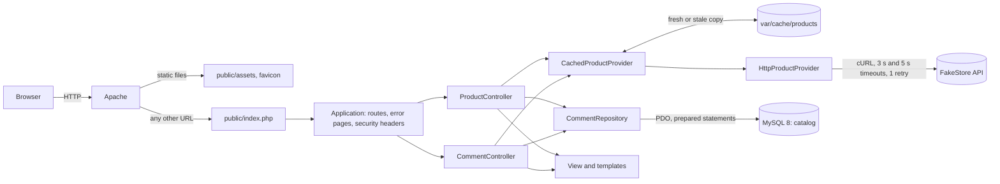

# Products Avenue

[](https://github.com/Adama-S/products-avenue/actions/workflows/ci.yml)

1. **Part 1, an e-commerce database** (`database/blissim.sql`): customers, products, orders and order lines, with the constraints that keep the data sane, a seed with edge cases and the two requested queries.
2. **Part 2, Products Avenue, a native PHP 8.5 catalogue**: products read from [FakeStore API](https://fakestoreapi.com) behind a cache, paginated, with customer reviews that visitors can add, edit and delete; only the reviews are stored, in MySQL, through PDO.
3. No framework: a small router, thin controllers, a repository, PHP templates and one native CSS file; everything runs with Docker Compose, in one command.

## Requirements

- **Docker Engine 20.10+ with Docker Compose v2.1.1+** (`docker compose`, for `up --wait`). Nothing else on the host: PHP, Composer and MySQL run in the containers.
- **Free ports `8050` (site) and `3350` (MySQL)**, both configurable in `.env`.
- **Internet access to `https://fakestoreapi.com`**, the product source.
- **Linux, macOS or Windows** (Docker Desktop, WSL 2). Tested versions and details: [docs/architecture.md](docs/architecture.md#requirements-in-detail).

## Installation and run

```bash
git clone https://github.com/Adama-S/products-avenue.git && cd products-avenue
cp .env.example .env                  # development values only, no secret
docker compose up -d --build --wait   # first start: a few minutes (image, databases, composer install)
```

Then open **http://localhost:8050** (health check: http://localhost:8050/health).

- **Port already allocated**: change `APP_PORT` or `DB_PORT` in `.env` (and `APP_URL` with it), then `docker compose up -d --wait`.
- **« Catalogue momentanément indisponible »**: FakeStore cannot be reached from the container; the cause is in `docker compose logs app`.
- **Reviews table missing after a schema change**: `docker compose down -v && docker compose up -d --wait` (this deletes local data).

First start step by step, run commands and Linux permissions: [docs/architecture.md](docs/architecture.md#running-and-troubleshooting).

## Database access

| | Value |
| --- | --- |
| Host and port (from your machine) | `localhost:3350` |
| Host and port (from the containers) | `db:3306` |
| Application user | `app` / `app_password` (rights on `catalog`, `catalog_test` and `blissim`) |
| Administrator | `root` / `root_password` |
| Databases | `blissim` (part 1), `catalog` (reviews), `catalog_test` (tests only) |

```bash
docker compose exec db mysql -uapp -papp_password catalog
```

These are local development values; a real deployment takes its secrets from its own environment.

## Tests

```bash
docker compose exec app composer check             # style, PHPStan and every test: what the CI runs
docker compose exec app composer test              # the three suites
docker compose exec app composer test:unit         # or test:integration, test:functional
docker compose exec app composer cs                # fix the code style
```

The tests were written first, story by story (test-driven development). No test calls the network; tests never touch the `catalog` database. The CI runs `composer check` in the same containers on every push and pull request. What each suite covers: [docs/architecture.md](docs/architecture.md#test-suites); manual acceptance checklist: [`RECETTE.md`](RECETTE.md).

## Checking part 1

`database/blissim.sql` creates the schema, loads the seed and runs the two requested queries. It can be loaded again at any time (`DROP TABLE IF EXISTS` in reverse order):

```bash
docker compose exec -T db mysql --default-character-set=utf8mb4 -uapp -papp_password < database/blissim.sql
```

Expected results (the seed dates are relative to `NOW()`, so they hold whatever the day):

- **Query 1**, customers who ordered product 1: Karim Benali, Sophie Martin, Sophie Martin. Two different customers share that name, and each appears once.
- **Query 2**, products sold during the last 7 days, by quantity: Eau micellaire 200 ml (8), Crème mains karité (7), Huile sèche corps (4), then Mascara volume, Masque tissu x5, Sérum visage hydratant 30 ml and Vernis à ongles rouge (1 each). The order placed 8 days ago is left out.

**The price paid is frozen.** Product 1 went from 22,90 € to 24,90 €; orders 1 and 2 keep the price paid at the time:

```sql
SELECT ol.order_id, ol.unit_price_cents, p.price_cents AS current_price_cents
FROM order_lines ol
JOIN products p ON p.id = ol.product_id
WHERE ol.product_id = 1
ORDER BY ol.order_id;
```

Expected: orders 1 and 2 at `2290`, orders 3 and 5 at `2490`; the current price (`current_price_cents`) is `2490` on every row.

Eight statements the database must refuse (quantity, price, name, currency, email, foreign keys): [docs/decisions.md](docs/decisions.md#part-1-statements-the-database-refuses).

## Architecture in brief



1. Apache serves only `public/`. Any URL that is not a file reaches `public/index.php`, which builds the objects and hands the request to `Application`.
2. `Application` routes the request, catches the business exceptions in one place to choose the page (404, 403, 503, 500), and adds the security headers.
3. Controllers are thin: they read the request, ask the product provider and the review repository, and hand the data to a template.
4. Products come from the cache when it is fresh; otherwise from FakeStore, through the HTTP adapter. During an API outage, a copy that expired less than 24 hours ago is served.
5. Reviews are read and written in MySQL through the repository, the only class that contains SQL.

Structure, routes, design patterns, SOLID and configuration: [docs/architecture.md](docs/architecture.md).

## Key decisions

- [FakeStore rather than DummyJSON](docs/decisions.md#fakestore-rather-than-dummyjson): its products hold what the brief asks for (title, image, price), and our database is the only source of reviews.
- [The API is the product source, no products table](docs/decisions.md#the-api-is-the-product-source-no-products-table): only reviews are stored.
- [File cache rather than Redis](docs/decisions.md#file-cache-rather-than-redis): one file per key behind `CacheInterface`, enough on one server.
- [Native PHP rather than Symfony](docs/decisions.md#native-php-rather-than-symfony): the routing, CSRF, validation and caching stay visible.
- [No foreign key on reviews](docs/decisions.md#no-foreign-key-on-reviews): the application checks that the product exists before saving.
- [Stale copy served for 24 hours at most](docs/decisions.md#stale-copy-served-for-24-hours-at-most): the catalogue stays up during an API outage, without old prices.
- [Product page in `no-store`](docs/decisions.md#product-page-in-no-store): it holds a CSRF token per visitor; only the catalogue is publicly cached.
- [Dates in UTC](docs/decisions.md#dates-in-utc): stored in UTC, shown in Europe/Paris.
- [Numeric ids in URLs](docs/decisions.md#numeric-ids-in-urls): security relies on server checks, not on ids hard to guess.
- [Native CSS rather than Bootstrap or Tailwind](docs/decisions.md#native-css-rather-than-bootstrap-or-tailwind): one file, no build step, fits the strict CSP.
- [Reviews editable by anyone](docs/decisions.md#reviews-editable-by-anyone): no authentication asked; verified purchases are the production answer.

More details on each decision (context, choice, rejected alternative): [docs/decisions.md](docs/decisions.md).

## Using AI

The application was built with an AI assistant, Claude Code (Anthropic), story by story and test first, under my review. Part 1 (`database/blissim.sql`) and the project skeleton (Docker, CI, quality tools) were done before this phase.

- **The AI** wrote the code, the tests, the templates and the CSS from the mockups, `database/catalog.sql`, the updates of `RECETTE.md` and drafts of this documentation; it ran the checks and verified the behaviour in the real application (Apache, the real FakeStore API, screenshots compared with the mockups at 1280 and 390 pixels).
- **I** provided the user stories, the technical choices and the mockups, reviewed every story before its commit, ran the tests and the acceptance checklist, and decided during reviews: the breadcrumb as in the mockups, no `maxlength` on the review field, a 404 title per case, no unused code (`Money::add()`), the injected logger kept for later, the favicon, fewer functional tests (75 down to 48), a compact stylesheet, the content of this README.
- **Found by checking for real, then fixed with a test**: init scripts without the executable bit (the CI could not start MySQL), the ETag changed by gzip (no 304 for browsers), a review in Latin-1 causing a 500, acceptance steps using `restart`, which does not reload `.env`.

## Going further

### Next product steps
1. **Star ratings on comments, average per product**: a `rating` column (`CHECK` 1 to 5) and one more rule in `CommentValidator`; the average per card comes from the same single `GROUP BY` query as `countByProducts()`, on the same index. FakeStore's own `rating` field stays ignored: our database remains the only source of reviews.
2. **Categories and tags, filters and sorting (products and comments)**: FakeStore already sends `category` and exposes `/products/categories`; `HttpProductProvider` only has to map it into `Product`, and filtering or sorting happens on the cached list, like the pagination. Sort options follow the `PerPage` pattern (closed enum, kept in the URL); reviews get a whitelisted `ORDER BY`.
3. **Search: MySQL FULLTEXT first, Algolia or Elasticsearch at scale**: behind a small search interface, like `ProductProviderInterface`, so the engine changes without touching the controllers; FULLTEXT needs the products in the database (see below), reviews can be searched today.
4. **Customer accounts and verified-purchase reviews (part 1 orders), moderation, anti-spam**: a review is accepted only if an `order_lines` row links the customer to the product, the same `EXISTS` as query 1 of part 1; the session and the CSRF token already exist. Then a `status` column for moderation, a honeypot field and a rate limit per IP.
5. **Product gallery (needs a source with several images)**: FakeStore gives one image, so `Product::$imageUrl` would become a list and the product template a gallery; nothing else changes.
6. **Checkout funnel and stock management: a project of its own**: part 1 already models orders with a frozen `unit_price_cents` and a currency per order, and `Money` is already ready for several currencies (amount in cents with its ISO code, symbols for EUR, USD and GBP); a cart, payment and stock deserve their own design.

### Technical next steps
- **Products stored in the database, synced from the supplier API**: a `DatabaseProductProvider` implementing `ProductProviderInterface`, fed by a scheduled import that reuses `HttpProductProvider` as its source; controllers and templates do not change.
- **Product name in URLs, sitemap.xml**: `/products/5-fjallraven-backpack` with a 301 when the name changes; only `PathId` (which reads ids from the URL) and `ProductPage::url()` (which builds every product link) change; the sitemap is generated from the cached product list.
- **Language files**: the interface is in French only; its texts would move to `lang/fr.php`, read by a `t()` helper next to `e()` in `src/View/functions.php`, and `CommentNotice` already maps keys to messages; a second language would get a URL prefix (`/en/...`) and `hreflang` links, with canonicals still built in one place.
- **Versioned migrations, monitoring and alerts, Symfony on a real project**: `catalog.sql` is replayable today, Doctrine Migrations or Phinx would version it; logs already carry the URL, the HTTP status and the duration, and stale copies are logged, ready to become metrics and alerts once a PSR-3 logger (Monolog) is injected instead of `error_log()`; the layers map one to one onto Symfony (controllers, repository, cache decorator, HttpClient, Form and CSRF components).
