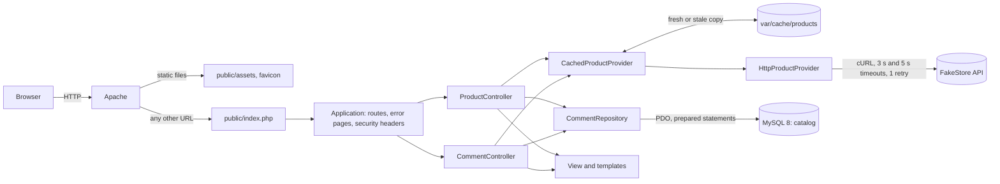

# Products Avenue

[](https://github.com/Adama-S/products-avenue/actions/workflows/ci.yml)

Blissim technical test, in two independent parts:

1. **An e-commerce database** (`database/blissim.sql`): customers, products, orders and order lines, with the constraints that keep the data sane, a seed with edge cases and the two requested queries.
2. **Products Avenue, a native PHP 8.5 catalogue**: products read from [FakeStore API](https://fakestoreapi.com) behind a cache, paginated, with customer reviews that visitors can add, edit and delete. Only the reviews are stored, in MySQL, through PDO.

No framework: a small router, thin controllers, a repository, PHP templates and one native CSS file. Everything runs with Docker Compose, in one command.

## Requirements

| Tool | Version | Why |
| --- | --- | --- |
| Docker Engine | 20.10 or later | Runs PHP 8.5 with Apache, and MySQL 8.0 |
| Docker Compose | v2.1.1 or later (`docker compose`, not `docker-compose`) | `up --wait` waits until both services are healthy |
| Git | any | To clone the repository |
| Free ports | `8050` (site) and `3350` (MySQL) | Both can be changed in `.env` |
| Internet access | to `https://fakestoreapi.com` | The product source; the cache keeps the catalogue up during a short outage |

- **Nothing else on the host**: no PHP, Composer, MySQL or Node. Dependencies are installed inside the container on the first start.
- **Operating systems**: Linux, macOS, or Windows with Docker Desktop (WSL 2 back end). Tested with Docker 20.10.16 and Compose 2.6.0 on Windows 11, and on the GitHub Actions Ubuntu runner.
- **Windows**: `.gitattributes` keeps LF line endings on checkout, so the container shell scripts run whatever your Git settings.
- About 1 GB of disk for the images (`php:8.5-apache`, `mysql:8.0`).

## Installation

```bash
# 1. Get the code
git clone https://github.com/Adama-S/products-avenue.git
cd products-avenue

# 2. Create the local configuration (development values only, no secret)
cp .env.example .env

# 3. Build and start the stack, then wait until it is healthy
docker compose up -d --build --wait
```

The first start takes a few minutes:

1. Docker builds the PHP image (Apache, extensions `pdo_mysql` and `intl`, Composer).
2. MySQL starts with an empty volume and runs the init scripts in `docker/mysql/init/`: it creates `catalog` and `catalog_test`, loads `database/blissim.sql` (part 1) into `blissim`, and `database/catalog.sql` (the reviews table) into `catalog` and `catalog_test`.
3. The PHP container runs `composer install` (vendor/ is missing on a fresh clone), creates `var/cache` and `var/log`, then starts Apache.
4. `--wait` returns once MySQL answers and `GET /health` returns 200.

Then open **http://localhost:8050**.

**If something goes wrong**

| Symptom | Fix |
| --- | --- |
| `port is already allocated` | Change `APP_PORT` or `DB_PORT` in `.env` (and `APP_URL` with it), then `docker compose up -d --wait` |
| The catalogue shows « momentanément indisponible » | FakeStore cannot be reached from the container: check the network; the cause is in `docker compose logs app` |
| The reviews table is missing after a schema change | The init scripts only run on an empty volume: `docker compose down -v && docker compose up -d --wait` (this deletes local data) |
| Files in `var/` or `vendor/` belong to root (Linux) | Run Composer as the web user: `docker compose exec -u www-data app composer ...` |

## Run

| Command | Effect |
| --- | --- |
| `docker compose up -d --wait` | Start (or restart after a change in `.env`: `up` recreates the container, `restart` does not reload `.env`) |
| `docker compose logs -f app` | PHP and Apache logs: API errors, stale copies served, 503 causes |
| `docker compose stop` | Stop, keep the data |
| `docker compose down -v` | Stop and delete the databases |

- Site: http://localhost:8050
- Health check: http://localhost:8050/health

## Configuration

Every setting comes from the environment (`.env`, read by Docker Compose). An invalid value stops the application at startup with a clear message in the logs.

| Variable | Value in `.env.example` | Role |
| --- | --- | --- |
| `APP_PORT` | `8050` | Port of the site on your machine |
| `DB_PORT` | `3350` | Port of MySQL on your machine, for a GUI client |
| `APP_URL` | `http://localhost:8050` | Base of canonical links, Open Graph and structured data |
| `DB_HOST`, `DB_NAME`, `DB_USER`, `DB_PASSWORD` | `db`, `catalog`, `app`, `app_password` | Application database (tests force `catalog_test`) |
| `MYSQL_ROOT_PASSWORD` | `root_password` | MySQL administrator |
| `PRODUCTS_API_URL` | `https://fakestoreapi.com` | Products API |
| `PRODUCTS_API_CURRENCY` | `EUR` | Currency of the API prices (FakeStore gives none) |
| `PRODUCTS_PER_PAGE` | `10` | Default catalogue page size (visitors can pick 10, 20 or 30) |
| `CACHE_TTL` | `300` | Lifetime of the products cache, in seconds |

## Database access

| | Value |
| --- | --- |
| Host and port (from your machine) | `localhost:3350` |
| Host and port (from the containers) | `db:3306` |
| Application user | `app` / `app_password` (rights on `catalog`, `catalog_test` and `blissim`) |
| Administrator | `root` / `root_password` |
| Databases | `blissim` (part 1), `catalog` (reviews), `catalog_test` (tests only) |

```bash
docker compose exec db mysql -uapp -papp_password catalog
```

These are local development values; a real deployment takes its secrets from its own environment.

## HTTP endpoints

The application is server-rendered: each route returns an HTML page, except `/health` (JSON). Forms are plain HTML forms and work without JavaScript.

| Method | Path | Parameters | Responses | HTTP cache |
| --- | --- | --- | --- | --- |
| `GET` | `/` | `page` (1, 2…), `per_page` (10, 20 or 30) | 200 catalogue, 304 unchanged, 404 page out of range, 503 API down | `public, max-age=300`, weak `ETag`, no cookie |
| `GET` | `/products/{id}` | `comments_page` (1, 2…), `review` (`published`, `updated`, `deleted`: confirmation) | 200, 404 unknown product or review page, 503 | `no-store` |
| `POST` | `/products/{id}/comments` | form: `csrf_token`, `author`, `content` | 303 to the product page, 422 invalid input, 403 invalid token, 404 unknown product | `no-store` |
| `GET` | `/products/{id}/comments/{commentId}/edit` | `comments_page` (page to go back to) | 200 pre-filled form (`noindex`), 404 | `no-store` |
| `POST` | `/products/{id}/comments/{commentId}` | form: `csrf_token`, `author`, `content`, `comments_page` | 303, 422, 403, 404 | `no-store` |
| `POST` | `/products/{id}/comments/{commentId}/delete` | form: `csrf_token`, `comments_page` | 303, 403, 404 | `no-store` |
| `GET` | `/health` | | 200 `{"status":"ok","database":"up"}`, 503 when MySQL is down | `no-store` |

- **Ids** are plain positive integers: `0`, `01`, `abc` or 20 digits are a 404, checked before any API call or query.
- **A review is reached through its product**: a review of product 1 requested under `/products/2/...` is a 404, the same as an unknown review.
- **Static files** (`/assets/style.css`, `/assets/app.js`, `/favicon.svg`) are served by Apache; every other URL goes to `public/index.php`.
- **Security headers** on every response: `Content-Security-Policy` (scripts, styles and forms from the site only, images from FakeStore), `Referrer-Policy`, `X-Content-Type-Options: nosniff`, `X-Frame-Options: DENY`. The session cookie is `HttpOnly` and `SameSite=Lax`.

**FakeStore endpoints used**: `GET /products` (the whole catalogue, 20 products) and `GET /products/{id}`. FakeStore answers an unknown id with `200` and an empty body (checked on 31 October 2026): it is handled as « not found », like a 404.

## Architecture

### Request flow



1. Apache serves only `public/`. Any URL that is not a file reaches `public/index.php`, which builds the objects and hands the request to `Application`.
2. `Application` routes the request, catches the business exceptions in one place to choose the page (404, 403, 503, 500), and adds the security headers.
3. Controllers are thin: they read the request, ask the product provider and the review repository, and hand the data to a template.
4. Products come from the cache when it is fresh; otherwise from FakeStore, through the HTTP adapter. During an API outage, a copy that expired less than 24 hours ago is served.
5. Reviews are read and written in MySQL through the repository, the only class that contains SQL.

### Project structure

```text
.
├── public/                  web root, the only folder Apache serves
│   ├── index.php            Front Controller and Composition Root
│   ├── assets/style.css     the only stylesheet (native CSS)
│   ├── assets/app.js        delete confirmation and character counter (optional)
│   └── favicon.svg
├── src/                     application code (namespace App\, PSR-4)
│   ├── Config.php           settings read once from the environment
│   ├── Http/                Request, Response, Router, Application, PathId
│   │   └── Client/          HttpClientInterface, CurlHttpClient
│   ├── Controller/          ProductController, CommentController, ProductPage, HealthController
│   ├── Product/             Product, Money, PerPage, providers (HTTP, cached), exceptions
│   ├── Comment/             Comment, CommentRepository, CommentValidator, CommentForm, CommentNotice
│   ├── Cache/               CacheInterface, FileCache, ClockInterface, SystemClock
│   ├── Pagination/          Pagination (catalogue and reviews)
│   ├── Security/            Csrf
│   ├── View/                View (templates, JSON-LD), e() and french_datetime()
│   └── Database/            PdoFactory and its exceptions
├── templates/               PHP templates: layout, pages, partials (no business logic)
├── database/
│   ├── blissim.sql          part 1: schema, seed, the two queries
│   └── catalog.sql          the reviews table
├── tests/
│   ├── Unit/                no network, no database
│   ├── Integration/         CommentRepository and PdoFactory on catalog_test
│   ├── Functional/          the whole application with simulated requests
│   ├── Double/              fakes: HTTP client, product provider, clock
│   └── Support/             test helpers (application builder, temporary directory)
├── docker/                  PHP image, Apache and PHP settings, MySQL init scripts
├── docker-compose.yml       services app (PHP 8.5, Apache) and db (MySQL 8.0)
├── .github/workflows/ci.yml the same containers in CI: composer check on every push
└── RECETTE.md               acceptance test checklist
```

| Folder | Role and rule |
| --- | --- |
| `public/` | Nothing else is reachable over HTTP: `src/`, `.env` and `vendor/` never are |
| `src/Http/` | The only place that reads `$_GET`, `$_POST` and `$_SERVER` (`Request::fromGlobals()`) |
| `src/Controller/` | No SQL and no HTML: requests in, responses out |
| `src/Product/` | The only code that knows FakeStore's URLs and JSON is `HttpProductProvider` |
| `src/Comment/` | The only SQL of the application is in `CommentRepository` |
| `src/Security/` | `Csrf` is the only class that touches the session |
| `templates/` | Display only; every value is escaped with `e()` |
| `tests/` | Three PHPUnit suites, see « Tests » |

## Design patterns

Each pattern answers a need of this project. None is there « just in case ».

| Pattern | Where | Why |
| --- | --- | --- |
| **Adapter** | `HttpProductProvider` | FakeStore's format stays in one class, which turns its JSON into typed `Product` objects and handles every API error (timeouts, retry, invalid data). Changing the API means writing another provider, nothing else. |
| **Decorator** | `CachedProductProvider` | Adds the cache, and the stale copy during an outage, around the HTTP provider, with the same interface and without changing it. Controllers do not know whether a product comes from the cache. |
| **Repository** | `CommentRepository` | All the SQL of the reviews in one place, with prepared statements; every read and write checks the review id **and** the product id. |
| **DTO** | `Product`, `Comment` | Typed, read-only objects instead of raw arrays: a template cannot mistype a key, PHPStan checks every use. |
| **Value Object** | `Money` | An amount never exists without its currency; cents avoid float errors; formatting (`12,90 €`) and checks (no negative amount, ISO code) live in one place. |
| **Post/Redirect/Get** | `CommentController` | Every form answers with a 303 redirect: a refresh or a double click never posts a review twice. |
| **Front Controller** | `public/index.php` and `Application` | One entry point: routing, security headers and error pages are handled once for every URL. |
| **Composition Root** | `public/index.php` | The concrete classes are chosen in one place; the rest of the code depends on interfaces, so tests swap in fakes without any container. |

Small idioms that go with them: **named constructors** (`Money::fromCents()`, `Money::fromDecimal()`), **enums for closed lists** (`PerPage`, `CommentNotice`: a URL can only pick an allowed value), **one exception per business case** (`ProductNotFoundException`, `ProductApiUnavailableException`, `DatabaseUnavailableException`, `CommentNotFoundException`, `InvalidCsrfTokenException`), thrown where the problem is found and caught only in `Application`.

**Not used, on purpose**: a dependency injection container, a service locator, abstract factories, an ORM, an empty « service » layer between controllers and the repository, CQRS. At this size they would add ceremony, not value.

**SOLID in practice**

| Principle | In this code |
| --- | --- |
| Single responsibility | The provider talks to the API, the decorator caches, the repository does SQL, the controllers do HTTP, the validator checks input, `Csrf` handles the token |
| Open/closed | Redis or another API means a new class implementing an existing interface, without changing the others |
| Liskov substitution | The HTTP provider, the cached provider and the test fake honour the same contract, exceptions included |
| Interface segregation | Short interfaces: `ProductProviderInterface` (2 methods), `CacheInterface` (3), `HttpClientInterface` (1), `ClockInterface` (1) |
| Dependency inversion | Controllers depend on `ProductProviderInterface`; the concrete classes are chosen in `public/index.php` |

## Decisions

**FakeStore rather than DummyJSON**
- Context: the brief asks for products from a public API and reviews stored through PDO.
- Choice: FakeStore, which has no reviews: our database is the only source of truth for reviews.
- Rejected: DummyJSON, which ships its own comments: two sources of reviews to reconcile.

**The API is the product source, no products table**
- Context: products are read-only here and FakeStore is the reference.
- Choice: read them from the API behind a cache; only reviews are stored.
- Rejected: importing products into MySQL, a synchronisation to maintain for 20 read-only products (see « Going further »).

**File cache rather than Redis**
- Context: one server, and a cache that must survive an API outage.
- Choice: one file per key, atomic writes, behind `CacheInterface`.
- Rejected: Redis, one more service to run for no gain on one server; it becomes the first step when the site runs on several servers.

**Native PHP rather than Symfony**
- Context: the brief asks for a simple project that shows the fundamentals.
- Choice: native PHP 8.5 with Composer for autoloading and dev tools only; a router, a few controllers and templates.
- Rejected: Symfony, the right choice on a real project, but it would hide the routing, CSRF, validation and caching this test is meant to show.

**No foreign key on reviews**
- Context: a review points to a FakeStore product, which is not in the database.
- Choice: `product_external_id` without a foreign key; the application checks that the product exists in the API before saving (404 otherwise).
- Rejected: a local products table only to hold a foreign key, a copy of the API to keep in sync.

**Stale copy served for 24 hours at most**
- Context: a catalogue that goes down loses sales, but an old price is a problem too.
- Choice: during an API outage, a copy that expired less than 24 hours ago is served and a warning logged; a product not found is never served from an old copy.
- Rejected: no fallback (a 503 at the first outage) or no limit (prices days old).

**Product page in `no-store`**
- Context: the product page holds a CSRF token of its own for each visitor, confirmation messages and reviews that change.
- Choice: `Cache-Control: no-store`; only the catalogue is publicly cacheable, and it opens no session.
- Rejected: a public cache on the product page, which would serve one visitor's token to another.

**Dates in UTC**
- Context: MySQL runs in UTC in Docker, and local times are ambiguous when clocks change.
- Choice: the connection sets `time_zone = '+00:00'`, PHP works in UTC, and dates become Europe/Paris only when displayed (`french_datetime()`).
- Rejected: storing Paris time, where 02:30 on the last Sunday of October happens twice.

**Numeric ids in URLs**
- Context: `/products/5` and `/products/5/comments/12/edit` expose sequential ids.
- Choice: keep them; security relies on server checks (CSRF token, POST only for changes, review checked by id and product, `noindex`), not on ids hard to guess.
- Rejected: UUID or ULID, a heavier key and bigger indexes for no gain here. In production: the product name in the URL for SEO (`/products/5-product-name`, 301 when the name changes), and UUIDs for any private URL shared without a login.

**Native CSS rather than Bootstrap or Tailwind**
- Context: the brief asks for a light style, as a bonus.
- Choice: one native CSS file with variables, Grid and Flexbox; fluid `clamp()` values instead of breakpoints.
- Rejected: Bootstrap (about 200 KB for a few components, a recognisable template look, JavaScript components not needed here) and Tailwind (a build step with Node to stay light, or a CDN not meant for production, and utility classes that weigh on templates). Native CSS is enough at this size, reads without tools and fits the strict CSP; with a team and a design system, Tailwind or in-house components would be worth discussing.

**Reviews editable by anyone**
- Context: the brief requires no authentication.
- Choice: anonymous reviews with CSRF protection and validation, but no owner.
- Rejected: an account or an ownership token, which proves nothing about the purchase. In production, only a customer who ordered the product would review it: the part 1 schema already allows it through `orders` and `order_lines`.

## Tests

```bash
docker compose exec app composer test              # the three suites
docker compose exec app composer test:unit         # no network, no database
docker compose exec app composer test:integration  # CommentRepository on catalog_test
docker compose exec app composer test:functional   # the application with simulated requests
docker compose exec app composer phpstan           # static analysis, level 8
docker compose exec app composer cs:check          # code style (PER Coding Style 3.0), read-only
docker compose exec app composer cs                # fix the code style
docker compose exec app composer check             # style, PHPStan and every test: what the CI runs
```

| Suite | What it covers |
| --- | --- |
| Unit | `Money`, the HTTP provider with a fake HTTP client (timeouts, retry, invalid JSON, FakeStore's empty body), the cache decorator with a frozen clock (fresh, stale copy served, too old, not found), `FileCache`, `Pagination`, `Router`, `Config`, `CommentValidator`, `Csrf`, escaping, French dates, JSON-LD |
| Integration | `CommentRepository` on the real `catalog_test` database: order, pagination, single-query counts (checked with MySQL's query counter), CHECK constraints, UTC dates |
| Functional | Catalogue, pagination, page size, product page, the whole review flow, 404 and 503 pages, HTTP cache and 304, no cookie on the list, security headers, CSRF, structured data |

The tests were written first, story by story (test-driven development). No test calls the network; tests never touch the `catalog` database. The CI runs `composer check` in the same containers on every push and pull request.

## Acceptance testing

[`RECETTE.md`](RECETTE.md) is the manual acceptance checklist: 30 scenarios run in Docker against the real FakeStore API (setup, catalogue, pagination, reviews, validation, security, cache, API and database outages, HTTP cache, SEO, responsive, part 1, CI), each with its steps and expected result.

## Checking part 1

`database/blissim.sql` creates the schema, loads the seed and runs the two requested queries. It can be loaded again at any time (`DROP TABLE IF EXISTS` in reverse order):

```bash
docker compose exec -T db mysql --default-character-set=utf8mb4 -uapp -papp_password < database/blissim.sql
```

Expected results (the seed dates are relative to `NOW()`, so they hold whatever the day):

- **Query 1**, customers who ordered product 1: Karim Benali, Sophie Martin, Sophie Martin. Two different customers share that name, and each appears once.
- **Query 2**, products sold during the last 7 days, by quantity: Eau micellaire 200 ml (8), Crème mains karité (7), Huile sèche corps (4), then Mascara volume, Masque tissu x5, Sérum visage hydratant 30 ml and Vernis à ongles rouge (1 each). The order placed 8 days ago is left out.

**The price paid is frozen.** Product 1 went from 22,90 € to 24,90 €; orders 1 and 2 keep the price paid at the time:

```sql
SELECT ol.order_id, ol.unit_price_cents, p.price_cents AS current_price_cents
FROM order_lines ol
JOIN products p ON p.id = ol.product_id
WHERE ol.product_id = 1
ORDER BY ol.order_id;
```

| order_id | unit_price_cents | current_price_cents |
| --- | --- | --- |
| 1 | 2290 | 2490 |
| 2 | 2290 | 2490 |
| 3 | 2490 | 2490 |
| 5 | 2490 | 2490 |

**The database refuses absurd data on its own.** Each of these statements must fail, and nothing is changed:

| Rule | Statement | Error |
| --- | --- | --- |
| Quantity of at least 1 | `INSERT INTO order_lines (order_id, product_id, quantity, unit_price_cents) VALUES (9, 1, 0, 2490);` | `chk_order_lines_quantity` is violated |
| No negative price | `INSERT INTO products (name, price_cents) VALUES ('Test', -100);` | Out of range value for `price_cents` |
| No empty name | `INSERT INTO products (name, price_cents) VALUES ('   ', 100);` | `chk_products_name` is violated |
| ISO 4217 currency | `INSERT INTO orders (customer_id, currency) VALUES (1, 'eur');` | `chk_orders_currency` is violated |
| Unique email, whatever the case | `INSERT INTO customers (first_name, last_name, email) VALUES ('Sophie', 'Martin', 'SOPHIE.MARTIN@example.com');` | Duplicate entry for `uq_customers_email` |
| Known customer | `INSERT INTO orders (customer_id) VALUES (999);` | Foreign key `fk_orders_customer` fails |
| A sold product is kept | `DELETE FROM products WHERE id = 1;` | Foreign key `fk_order_lines_product` fails |
| A customer with orders is kept | `DELETE FROM customers WHERE id = 1;` | Foreign key `fk_orders_customer` fails |

Run them with `docker compose exec db mysql --default-character-set=utf8mb4 -uapp -papp_password blissim`.

## Going further

### Next product steps (by priority)
1. **Star ratings on comments, average per product**: a `rating` column (`CHECK` 1 to 5) and one more rule in `CommentValidator`; the average per card comes from the same single `GROUP BY` query as `countByProducts()`, on the same index. FakeStore's own `rating` field stays ignored: our database remains the only source of reviews.
2. **Categories and tags, filters and sorting (products and comments)**: FakeStore already sends `category` and exposes `/products/categories`; `HttpProductProvider` only has to map it into `Product`, and filtering or sorting happens on the cached list, like the pagination. Sort options follow the `PerPage` pattern (closed enum, kept in the URL); reviews get a whitelisted `ORDER BY`.
3. **Search: MySQL FULLTEXT first, Algolia or Elasticsearch at scale**: behind a small search interface, like `ProductProviderInterface`, so the engine changes without touching the controllers; FULLTEXT needs the products in the database (see below), reviews can be searched today.
4. **Customer accounts and verified-purchase reviews (part 1 orders), moderation, anti-spam**: a review is accepted only if an `order_lines` row links the customer to the product, the same `EXISTS` as query 1 of part 1; the session and the CSRF token already exist. Then a `status` column for moderation, a honeypot field and a rate limit per IP.
5. **Product gallery (needs a source with several images)**: FakeStore gives one image, so `Product::$imageUrl` would become a list and the product template a gallery; nothing else changes.
6. **Checkout funnel and stock management: a project of its own**: part 1 already models orders with a frozen `unit_price_cents` and a currency per order, and `Money` is already ready for several currencies (amount in cents with its ISO code, symbols for EUR, USD and GBP); a cart, payment and stock deserve their own design.

### Technical next steps
- **Products stored in the database, synced from the supplier API**: a `DatabaseProductProvider` implementing `ProductProviderInterface`, fed by a scheduled import that reuses `HttpProductProvider` as its source; controllers and templates do not change.
- **Product name in URLs, sitemap.xml**: `/products/5-fjallraven-backpack` with a 301 when the name changes; only `PathId` (which reads ids from the URL) and `ProductPage::url()` (which builds every product link) change; the sitemap is generated from the cached product list.
- **Versioned migrations, monitoring and alerts, Symfony on a real project**: `catalog.sql` is replayable today, Doctrine Migrations or Phinx would version it; logs already carry the URL, the HTTP status and the duration, and stale copies are logged, ready to become metrics and alerts once a PSR-3 logger (Monolog) is injected instead of `error_log()`; the layers map one to one onto Symfony (controllers, repository, cache decorator, HttpClient, Form and CSRF components).
